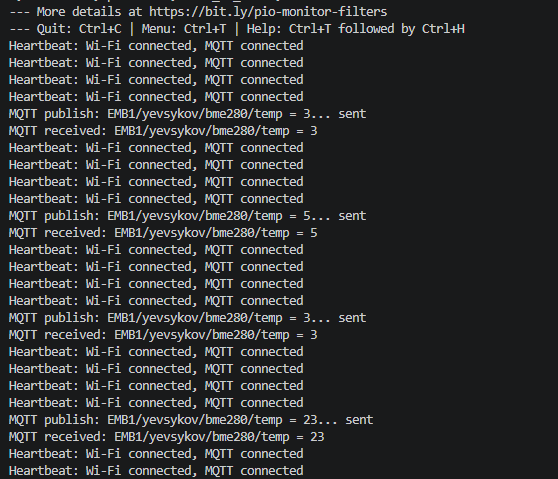
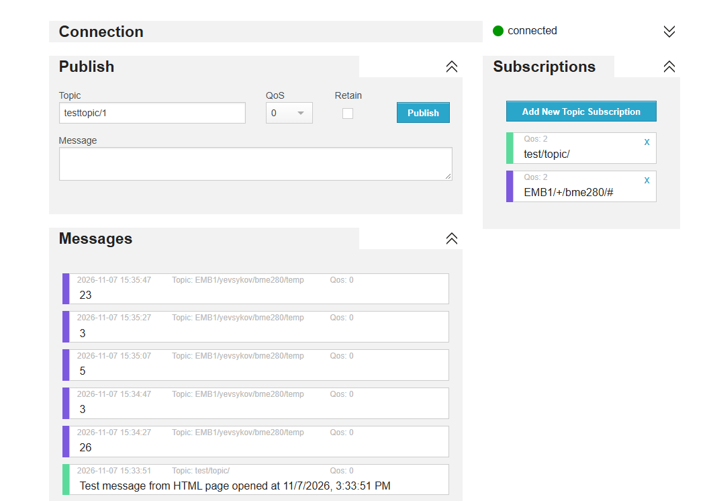
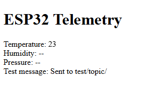

# ESP32 Learning Project

This is a small educational project for the [Embedded Development course](https://beetroot.academy/courses/online/kurs-embedded-development)

## Wi-Fi configuration

Wi-Fi credentials are stored in a local header and are not committed to git.
Copy the example file and replace the placeholders with your network details:

```powershell
Copy-Item .\include\secrets.h.example .\include\secrets.h
```

Then build and upload the project as usual with PlatformIO. The local
`include/secrets.h` file is ignored by git.


## Results

### Serial monitor  


### Hive logs 


### HTML


